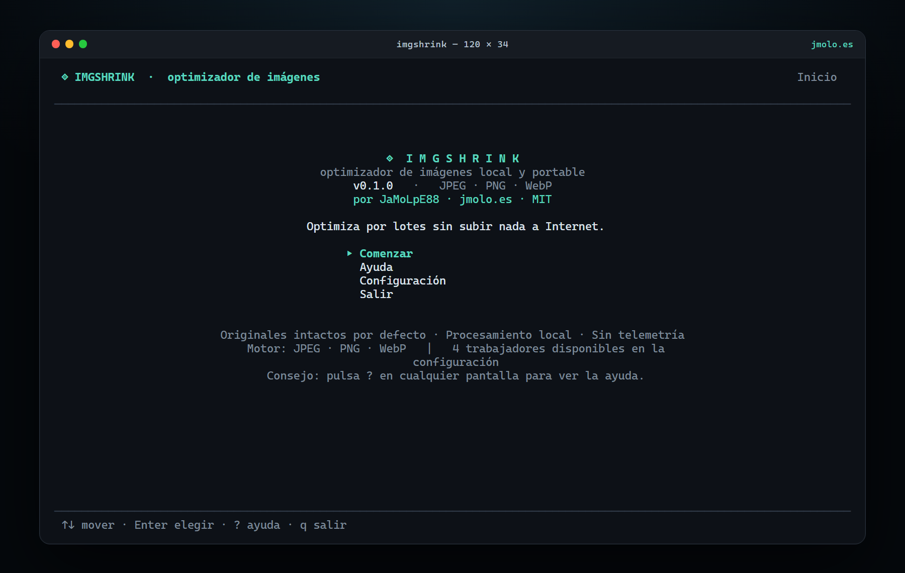
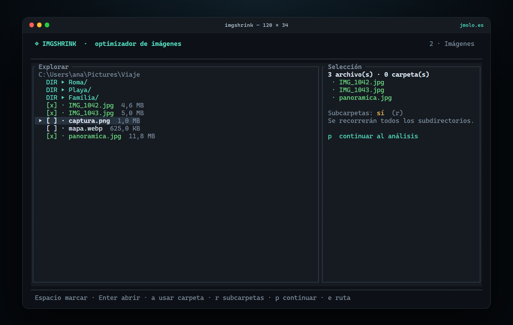
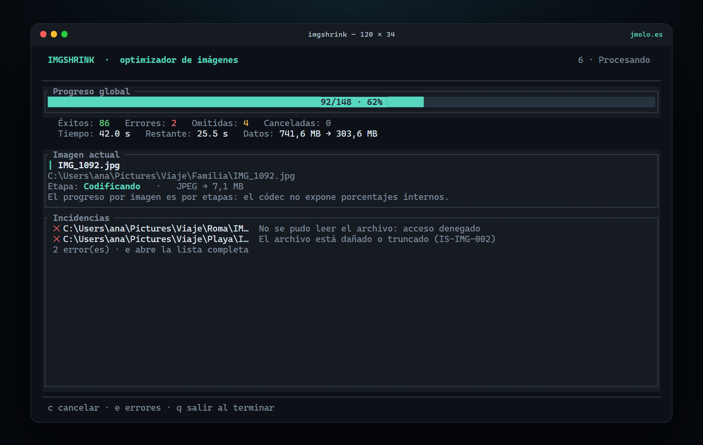
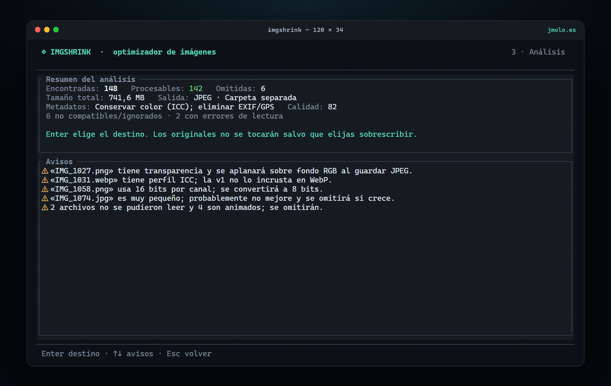
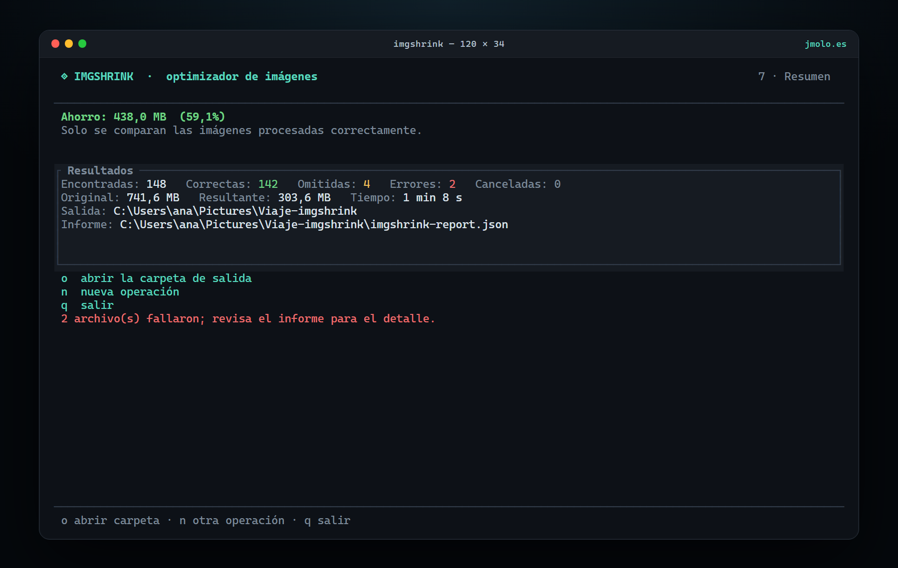
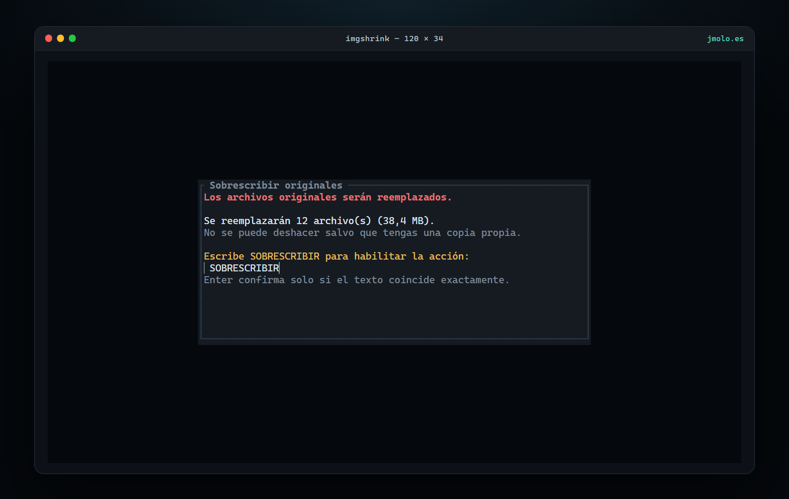

# ImgShrink

**Optimizador de imágenes local, portable y con interfaz de terminal.**
Reduce el peso de fotografías, capturas y gráficos sin subir nada a Internet. Se descarga un ejecutable, se abre desde la terminal y se usa, sin instalar Python, Node.js, FFmpeg, ImageMagick ni runtimes adicionales.

Por **[JaMoLpE88](https://github.com/JaMoLpE88)** · Web: **[jmolo.es](https://jmolo.es)** · Licencia **MIT**.

  

---

## Descargas

Los artefactos se publican en **[GitHub Releases](https://github.com/JaMoLpE88/ImgShrink/releases/latest)**. Elige el archivo de tu sistema, descomprímelo y ejecuta <code>imgshrink</code> desde una terminal.

| Sistema | Arquitectura | Descarga | Estado |
|---|---|---|---|
| Windows 11 | x64 | [ZIP](https://github.com/JaMoLpE88/ImgShrink/releases/latest/download/imgshrink-x86_64-pc-windows-msvc.zip) · [SHA-256](https://github.com/JaMoLpE88/ImgShrink/releases/latest/download/imgshrink-x86_64-pc-windows-msvc.zip.sha256) | Verificado localmente |
| macOS 13+ | Apple Silicon | [tar.gz](https://github.com/JaMoLpE88/ImgShrink/releases/latest/download/imgshrink-aarch64-apple-darwin.tar.gz) · [SHA-256](https://github.com/JaMoLpE88/ImgShrink/releases/latest/download/imgshrink-aarch64-apple-darwin.tar.gz.sha256) | Construido en CI |
| macOS 13+ | Intel | [tar.gz](https://github.com/JaMoLpE88/ImgShrink/releases/latest/download/imgshrink-x86_64-apple-darwin.tar.gz) · [SHA-256](https://github.com/JaMoLpE88/ImgShrink/releases/latest/download/imgshrink-x86_64-apple-darwin.tar.gz.sha256) | Construido en CI |
| Linux | x86_64 (musl) | [tar.gz](https://github.com/JaMoLpE88/ImgShrink/releases/latest/download/imgshrink-x86_64-unknown-linux-musl.tar.gz) · [SHA-256](https://github.com/JaMoLpE88/ImgShrink/releases/latest/download/imgshrink-x86_64-unknown-linux-musl.tar.gz.sha256) | Construido en CI |

> Windows 10 x64 funciona con el mismo ZIP (mejor esfuerzo; el sistema está fuera de soporte). Windows ARM64 y Linux ARM64 aún no se publican. macOS y Linux se compilan en CI, pero no se consideran verificados manualmente hasta que se prueben en máquinas limpias.

---

## Capturas

Las imágenes se han generado desde la **TUI real** (render de ratatui) con datos de demostración, no son mockups. Puedes regenerarlas con los comandos del apartado [Desarrollo](#desarrollo).

### Selección de imágenes

  

### Progreso en tiempo real

  

### Análisis previo

  

### Resumen final

  

### Confirmación de sobrescritura

  

---

## Qué hace

- **TUI completa:** paneles, tarjetas, diálogos, colores, iconos Unicode, modo ASCII y adaptación a terminales pequeñas.
- **Selección flexible:** archivos concretos, una carpeta, una carpeta con subcarpetas o una carpeta sin ellas.
- **Tres destinos:** carpeta separada (por defecto), junto al original con sufijo o sobrescritura con doble confirmación.
- **JPEG, PNG y WebP** de entrada y salida.
- **Compresión con y sin pérdida** cuando el formato lo permite.
- **Perfiles guiados** y editor manual de formato, calidad, redimensionado, metadatos y conflictos.
- **Escritura segura:** temporal en la misma carpeta, validación del resultado y solo después reemplazo.
- **Progreso honesto:** global y por etapas; no se inventan porcentajes internos del códec.
- **Cancelación controlada**, informe JSON y resumen verificable.
- **Sin telemetría, sin cuentas y sin conexión de red.**

### Lo que no hace

- No procesa vídeo, GIF animado ni APNG.
- No incluye AVIF en 0.1.0.
- No edita fotografías ni aplica filtros creativos.
- No garantiza que todas las imágenes reduzcan tamaño. Si el resultado no es menor, la política por defecto conserva el original y lo marca como omitido.
- No promete atomicidad universal en unidades de red o con bloqueos de antivirus.

---

## Instalación y ejecución por sistema operativo

ImgShrink es una aplicación de terminal: ábrela desde Windows Terminal, PowerShell, Terminal.app o una terminal Linux. No está pensada para ejecutarse con doble clic y que la ventana se cierre al terminar.

### Windows 11

~~~powershell
Expand-Archive .\imgshrink-x86_64-pc-windows-msvc.zip -DestinationPath .\imgshrink
cd .\imgshrink
.\imgshrink.exe
~~~

- Si SmartScreen muestra un aviso, usa **Más información → Ejecutar de todas formas** o firma el binario en una release futura.
- El ZIP incluye el ejecutable, el README, la licencia y los avisos de terceros.
- Para comprobar el motor sin abrir la interfaz: <code>.\imgshrink.exe --selftest</code>.

### macOS 13+ (Apple Silicon o Intel)

~~~bash
tar -xzf imgshrink-aarch64-apple-darwin.tar.gz   # o x86_64 en un Mac Intel
cd imgshrink-aarch64-apple-darwin
chmod +x imgshrink
./imgshrink
~~~

- Gatekeeper puede bloquear un binario sin firma. Abre con clic derecho → **Abrir**, o revisa **Ajustes del Sistema → Privacidad y seguridad**.
- Si el archivo se descargó con cuarentena: <code>xattr -d com.apple.quarantine imgshrink</code>.
- La firma y notarización están pendientes; se documentará cuando estén disponibles.

### Linux x86_64

~~~bash
tar -xzf imgshrink-x86_64-unknown-linux-musl.tar.gz
cd imgshrink-x86_64-unknown-linux-musl
chmod +x imgshrink
./imgshrink
~~~

- El artefacto es **musl estático**: no depende de la versión de glibc de la distribución.
- Necesita una terminal interactiva con soporte de colores. Si no hay color o el ratón estorba: <code>--no-color</code>, <code>--ascii</code> o <code>--no-mouse</code>.
- En servidores sin terminal interactiva puedes usar <code>--selftest</code> y <code>--diagnose</code>.

### Comprobar la descarga

Cada release publica un archivo <code>.sha256</code>. En Windows:

~~~powershell
Get-FileHash .\imgshrink-x86_64-pc-windows-msvc.zip -Algorithm SHA256
~~~

En macOS/Linux:

~~~bash
sha256sum -c imgshrink-x86_64-unknown-linux-musl.tar.gz.sha256
~~~

---

## Cómo se usa

La aplicación guía por siete pasos:

1. **Finalidad:** Compartir, Ahorrar espacio, Web o Personalizado.
2. **Selección:** navega, marca archivos y añade carpetas; decide si incluir subcarpetas.
3. **Análisis:** revisa cuántas imágenes hay, su tamaño, conflictos y avisos.
4. **Destino:** carpeta separada, sobrescritura o sufijo.
5. **Revisión:** comprueba la configuración y ajusta opciones con <code>o</code>.
6. **Proceso:** progreso global, imagen actual, etapas y errores.
7. **Resumen:** ahorro real, tiempos, informe y carpeta de salida.

### Atajos

| Tecla | Acción |
|---|---|
| <code>↑</code> <code>↓</code> o <code>j</code> <code>k</code> | Mover |
| <code>Enter</code> | Abrir, elegir o confirmar |
| <code>Espacio</code> | Marcar o desmarcar archivo |
| <code>Esc</code> | Volver |
| <code>?</code> | Ayuda contextual |
| <code>q</code> | Salir |
| <code>Ctrl+C</code> | Cancelar o salir de forma controlada |
| <code>e</code> o <code>/</code> | Escribir una ruta |
| <code>a</code> | Añadir la carpeta actual |
| <code>r</code> | Incluir o excluir subcarpetas |
| <code>x</code> | Vaciar la selección |
| <code>h</code> | Mostrar archivos ocultos |
| <code>p</code> | Continuar al análisis |
| <code>c</code> | Cambiar conflictos (destino) o cancelar (proceso) |
| <code>o</code> | Opciones de optimización (revisión) u abrir carpeta (resumen) |
| <code>n</code> | Nueva operación (resumen) |

### Ejemplo reproducible

~~~bash
mkdir -p ~/Pictures/prueba
cp ~/Pictures/foto.jpg ~/Pictures/prueba/
cd ~/Pictures/prueba
imgshrink
~~~

Elige una finalidad, marca <code>foto.jpg</code>, pulsa <code>p</code>, revisa el destino y procesa. La salida aparecerá en <code>imgshrink-output/</code> y los originales no se modificarán.

---

## Perfiles de optimización

Los perfiles son puntos de partida documentados, no promesas de ahorro. Se pueden ajustar desde la revisión con <code>o</code>.

| Perfil | Formato de salida | Calidad | Pérdida | Redimensionado | Metadatos |
|---|---|---|---|---|---|
| Compartir | Mantener el original | 82 | Sí en JPEG/WebP; PNG sin pérdida | No | Elimina EXIF/GPS/XMP; conserva ICC si el formato lo admite |
| Ahorrar espacio | Mantener el original | 90 en JPEG | PNG/WebP sin pérdida; JPEG con pérdida | No | Elimina EXIF/GPS/XMP; conserva ICC |
| Web | WebP | 80 | Sí | No en v1 | Elimina EXIF/GPS/XMP; ICC no se incrusta en WebP |
| Personalizado | Elegible | 85 inicial | Elegible | Opcional, solo reduce | Elegible |

Notas:

- **JPEG no admite compresión sin pérdida.** El perfil Ahorrar espacio usa calidad 90 y avisa de que sigue habiendo pérdida.
- **PNG** se optimiza sin pérdida con oxipng. La calidad no aplica.
- **WebP** puede ser sin pérdida o con pérdida; el perfil Web usa pérdida para fotografías.
- **No se amplía** ninguna imagen. El redimensionado solo reduce el lado mayor.
- **No se cambia el formato** en el modo de sobrescritura; si lo intentas, la imagen se omite.
- La política por defecto **no escribe** un resultado que sea mayor que el original. Se puede desactivar en Opciones.

---

## Formatos y metadatos

| Entrada | Salida | Notas |
|---|---|---|
| JPEG 8 bits | JPEG | Se aplana la transparencia si la hubiera; CMYK puede fallar y se reporta |
| PNG 8/16 bits | PNG | 16 bits se convierte a 8; APNG se omite |
| WebP estático | WebP | Animados se omiten |
| AVIF | — | No incluido en 0.1.0 |

- La orientación EXIF de JPEG se aplica a los píxeles y se normaliza para evitar dobles rotaciones.
- El perfil ICC se conserva en JPEG (APP2) y PNG (iCCP) cuando la política es «Conservar color (ICC)».
- En WebP, la versión 0.1.0 **no incrusta ICC**; la interfaz avisa cuando la imagen de origen lo tiene.
- Los metadatos EXIF, GPS y XMP se eliminan en todos los perfiles de esta versión.
- Las imágenes con 16 bits por canal se convierten a 8 bits y se avisa.

---

## Modos de salida y seguridad

### Carpeta separada (predeterminada)

Se conserva la estructura relativa de las carpetas. Si eliges una carpeta de entrada <code>Fotos</code>, la salida propuesta es <code>Fotos-imgshrink</code> en el mismo nivel. Nunca se mezclan resultados con originales por defecto.

### Junto al original con sufijo

<code>vacaciones.jpg</code> → <code>vacaciones-imgshrink.webp</code> (el sufijo y el formato son configurables). Si el destino existe, se aplica la política elegida: omitir, sobrescribir o renombrar con <code>-1</code>, <code>-2</code>…

### Sobrescribir originales

Desactivado por defecto. Requiere:

1. Una primera confirmación con el número de archivos y el tamaño afectado.
2. Escribir exactamente <code>SOBRESCRIBIR</code> y pulsar Enter.

Antes de sustituir un original, ImgShrink:

1. Escribe el resultado en un archivo temporal de la misma carpeta.
2. Fuerza la escritura a disco.
3. Vuelve a decodificar el temporal para comprobar que es legible.
4. Comprueba que el original no cambió desde el análisis.
5. Solo entonces lo reemplaza.

En POSIX, el reemplazo en el mismo sistema de archivos es atómico. En Windows se usa la primitiva de reemplazo del sistema, pero antivirus, filtros y unidades de red pueden impedir la garantía. Si el proceso muere, el journal permite detectar la operación inacabada; no se borran datos automáticamente.

---

## Límites conocidos

- No se fuerza el tamaño de la ventana de la terminal. Si es pequeña se muestra un modo compacto o un aviso.
- No se comprueba el espacio libre antes de empezar; un fallo de escritura se reporta sin tocar el original.
- No hay recuperación automática del journal: se avisa de operaciones inacabadas para revisarlas a mano.
- Los metadatos EXIF/GPS/XMP se eliminan siempre en 0.1.0; solo el ICC es conservable.
- Las colisiones de nombres se detectan con normalización Unicode NFC y, en Windows/macOS, sin distinguir mayúsculas.
- Las rutas de red y algunos sistemas de archivos no garantizan atomicidad.
- No hay AVIF ni animaciones.
- Los binarios no están firmados; Windows SmartScreen y macOS Gatekeeper pueden avisar.

---

## Solución de problemas

| Problema | Solución |
|---|---|
| «La terminal es demasiado pequeña» | Amplía la ventana; el mínimo es 50×14. |
| «ImgShrink necesita una terminal interactiva» | Ejecútalo desde una terminal real, no desde una tubería. |
| No se ven colores o iconos | Usa <code>--no-color</code> o <code>--ascii</code>. |
| El ratón estorba | Usa <code>--no-mouse</code>. |
| No aparecen archivos | Pulsa <code>h</code> para ocultos o <code>e</code> para escribir otra ruta. |
| Error de permisos | Comprueba la carpeta de destino y evita rutas protegidas del sistema. |
| Archivo bloqueado en Windows | Cierra el programa que lo usa; el original no se toca si falla. |
| macOS bloquea el binario | Clic derecho → Abrir, o revisa Privacidad y seguridad. |
| Windows SmartScreen | Más información → Ejecutar de todas formas. |
| Quiero ver qué falló | Revisa el informe JSON y el registro en el directorio de estado. |
| Quiero comprobar el entorno | <code>imgshrink --diagnose</code> |

Directorios de estado:

- Windows: <code>%LOCALAPPDATA%\ImgShrink</code>
- macOS: <code>~/Library/Logs/ImgShrink</code>
- Linux: <code>$XDG_STATE_HOME/imgshrink</code> o <code>~/.local/state/imgshrink</code>

---

## Desarrollo

### Requisitos

- Rust estable (probado con 1.99.1; mínimo 1.85).
- Un compilador de C para libwebp: MSVC Build Tools en Windows, clang/gcc en macOS/Linux.
- Git.
- Chrome solo si vas a regenerar las capturas del README.
- No se necesita FFmpeg, ImageMagick, Python ni Node.js para usar la aplicación.

### Comandos

~~~bash
cargo run -p imgshrink-cli
cargo test --workspace
cargo clippy --workspace --all-targets -- -D warnings
cargo fmt --all --check
cargo run -q -p imgshrink-cli -- --selftest
cargo run -q -p imgshrink-cli -- --diagnose
~~~

### Generar un ejecutable

~~~bash
cargo build --release -p imgshrink-cli
./target/release/imgshrink --selftest
~~~

En Windows, con CRT estático:

~~~powershell
$env:RUSTFLAGS = "-C target-feature=+crt-static"
cargo build --release --target x86_64-pc-windows-msvc -p imgshrink-cli
.\target\x86_64-pc-windows-msvc\release\imgshrink.exe --selftest
~~~

El workflow <code>.github/workflows/release.yml</code> construye Windows x64, macOS ARM64, macOS x64 y Linux x64 musl, ejecuta el selftest en los targets nativos y publica los archivos en GitHub Releases.

### Estructura

~~~text
crates/
  imgshrink-core/   Dominio: descubrimiento, motor, salidas, trabajos, informe
  imgshrink-tui/    Interfaz ratatui, estado, pantallas, entrada y ejemplo de capturas
  imgshrink-cli/    Binario, clap, logging, selftest y diagnose
docs/               Arquitectura, formatos, empaquetado, pruebas, ADRs e imágenes
.github/workflows/  CI y releases
scripts/            Captura de pantallas para el README
~~~

### Regenerar las capturas

~~~bash
cargo run -p imgshrink-tui --example gallery
powershell -NoProfile -ExecutionPolicy Bypass -File scripts/capture-screenshots.ps1
~~~

El ejemplo renderiza las pantallas reales con datos de demostración y Chrome las convierte en PNG. Las imágenes se guardan en <code>docs/images/</code>.

### Pruebas

- 18 pruebas unitarias del núcleo.
- 6 pruebas de integración por lotes.
- 3 pruebas de flujo y edición de la TUI.
- 5 pruebas de renderizado en distintos tamaños de terminal.
- 1 prueba PTY que lanza el binario real y comprueba la restauración de la terminal.

~~~bash
cargo test --workspace
~~~

---

## Privacidad

Todo el procesamiento ocurre en el equipo. ImgShrink no abre conexiones de red, no envía imágenes, rutas ni estadísticas y no incluye telemetría. Los informes y registros son archivos locales.

---

## Autoría y licencia

- **Autor:** [JaMoLpE88](https://github.com/JaMoLpE88)
- **Web:** [jmolo.es](https://jmolo.es)
- **Repositorio:** [github.com/JaMoLpE88/ImgShrink](https://github.com/JaMoLpE88/ImgShrink)
- **Licencia:** MIT.

Copyright (c) 2026 **JaMoLpE88** — [https://jmolo.es](https://jmolo.es)

Se permite usar, copiar, modificar, fusionar, publicar, distribuir, sublicenciar y vender el software, siempre que se conserve el aviso de copyright y la licencia. El software se ofrece sin garantías. Consulta [LICENSE](LICENSE).

## Avisos de terceros

Las dependencias y sus licencias se listan en [THIRD_PARTY.md](THIRD_PARTY.md). Las principales son ratatui/crossterm (MIT), image/png/oxipng (MIT o Apache-2.0), libwebp (BSD-3-Clause) y kamadak-exif (BSD-2-Clause).

AVIF y WebP tienen patentes libres de regalías según sus promotores; esta nota no es asesoramiento legal.
